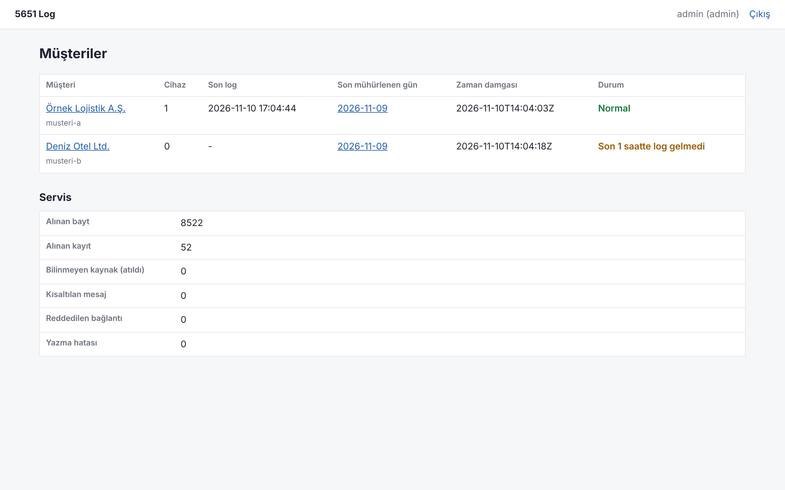

# 5651-custom-syslog

Firewall loglarını toplayıp 5651 sayılı kanuna uygun şekilde saklayan, çok müşterili (multi-tenant) bir syslog servisi. SIEM istemeyen müşteriler için tasarlandı: logu alır, kayıpsız ve yüksek oranla sıkıştırır, hash zinciriyle mühürler, her gün RFC 3161 (KamuSM) zaman damgası alır, saklama süresi dolunca denetim kaydıyla siler ve müşteri bazında bir web arayüzü sunar.

Kurulum için: [KURULUM.md](KURULUM.md)



## Nasıl çalışır

1. **Alım:** UDP 514, TCP 514 (RFC 6587 çerçeveleme) ve TLS 6514 (RFC 5425). Kaynak IP müşteriye eşlenir; tanımsız kaynaklar reddedilir.
2. **Ham dosya:** Her kayıt değiştirilmeden, alınma zamanı (UTC, nanosaniye) ve kaynak IP ile saatlik dosyaya yazılır: `<müşteri>/<gün>/<cihaz>/<saat>.log`
3. **Saatlik mühür:** Biten saat sütunlu formatta sıkıştırılır (`.s5651`), açılıp ham dosyanın SHA-256'sıyla karşılaştırılır, `hours.jsonl` dosyasına hash zinciriyle eklenir, ardından ham dosya silinir.
4. **Günlük mühür:** Gün bitince müşteri başına bir `manifest.json` (tüm dosyaların hash'leri, önceki günün manifest hash'i) oluşturulur ve RFC 3161 zaman damgası alınır (`manifest.json.tsr`). Müşteri başına günde 1 damga harcanır.
5. **Saklama:** Varsayılan 730 gün, müşteri bazında değiştirilebilir. Silmeden önce denetim kaydı yazılır; mühürlenmemiş gün hiçbir zaman silinmez.
6. **Arama indeksi:** Her mühürlü saat için küçük bir Bloom filtresi (`.idx`) yazılır. Mühürün dışında durur, kaybolursa yeniden oluşturulur; aranan kelimenin geçmediği saatler hiç açılmaz.

## Web paneli

- **Genel bakış:** son 24 saat ve 30 günün log grafikleri, müşteri tablosu (son log, disk kullanımı, sıkıştırma oranı, lisans, mühür durumu; sütuna tıklayarak sıralama), sunucu durumu (çalışma süresi, disk, RAM, CPU, sertifika ve zaman damgası süreleri) ve dikkat isteyen durumlar.
- **Müşteri ve gün sayfaları:** tarih aralığı ve duruma göre filtre, saatlik dosyalar, cihaz adları, bütünlük doğrulama, denetim için zip paketi.
- **Arama:** tarih ve saat aralığı, cihaz, tam kelime ya da metin içinde.
- **Log kaynakları:** müşteri ekleme, firewall IP'si ekleme/kaldırma, bilinmeyen kaynaklar, saklama süresi ve lisans tarihi. Yeniden başlatma gerekmez.
- **E-posta uyarıları:** log kesintisi, mühürlenemeyen gün, disk, yazma hatası, lisans ve sertifika bitişi; izleme araçları için `/healthz`.
- **Aylık rapor:** müşteriye verilecek, yazdırılabilir saklama ve bütünlük raporu. Arama sonuçları CSV olarak indirilebilir.
- **Kullanıcılar, Hesabım (iki adımlı giriş), Ayarlar, Denetim kaydı.**

## Sıkıştırma

Firewall logları çoğunlukla `anahtar=değer` çiftlerinden oluşur. `colz` formatı her satırı bir şablona (anahtarların sırası) ve sütunlara (her anahtarın değerleri) ayırır, artan sayıları (zaman, eventtime) fark olarak saklar ve her sütunu ayrı sıkıştırır. Dönüşüm bayt bayt geri alınabilir; her mühürlemede bu kontrol edilir.

Aynı sentetik FortiGate verisi (150.000 satır, alanların çoğu rastgele, yani en kötü durum):

| Yöntem | Oran |
| --- | --- |
| xz -9e (düz dosya) | 11,4x |
| zstd, sütunlu | 13,5x |
| **xz -9e, sütunlu (varsayılan)** | **15,2x** |

Daha gerçekçi tekrarlı demo verisinde sütunlu zstd ile saatlik dosyalar 25x civarında sıkışıyor. Gerçek müşteri loguyla ölçmek için:

```bash
COLZ_BENCH=/yol/ham.log go test ./internal/colz/ -run TestBenchFile -v
```

## Kapasite (ölçülen)

4 çekirdekli test sunucusunda, yük üreteci aynı makinede çalışırken (FortiGate benzeri ~700 bayt mesajlar):

| Alım | Hız | Kayıp |
| --- | --- | --- |
| UDP | 92.000 mesaj/sn | 0 |
| TCP (8 bağlantı) | 90.000 mesaj/sn | 0 |
| TLS (8 bağlantı) | 92.000 mesaj/sn | 0 |
| UDP | 146.000 mesaj/sn | %2,6 (tek çekirdek doldu; UDP'nin doğası gereği çekirdek fazlasını düşürür) |

Mühürleme: 5,8 GB'lık tek bir saat (8,3 milyon satır) xz ile 289 MB'a indi (20,2x), tek çekirdekte 19 dakika sürdü. Bir sıkıştırma işçisi xz ile saniyede ~5,6 MB (~8.000 mesaj/sn sürekli), zstd ile ~25 MB işler; sürekli yük bunu aşacaksa `compression.workers` artırılır ya da `codec: zstd` seçilir (aynı veride oran ~%13 düşük).

## Güvenlik

- Servis root olmayan kullanıcıyla, kısıtlamalı systemd birimiyle çalışır (sadece `CAP_NET_BIND_SERVICE`; salt okunur sistem; seccomp filtresi).
- Veri klasörü `0700`, mühürlü dosyalar `0400`; web ve doğrulama tarafındaki dosya okumaları ile saklama silmeleri `os.Root` ile veri klasörüne hapsedilir.
- Web: sadece HTTPS (TLS 1.2+), HSTS, sıkı CSP (hiç JavaScript yok), `__Host-` çerezler (Secure, HttpOnly, SameSite=Strict), her POST'ta CSRF token, argon2id şifreler, IP ve kullanıcı bazında artan kilitleme, müşteri izolasyonu (başka müşterinin sayfası 404 döner), tüm giriş/arama/indirme işlemleri denetim kaydına yazılır.
- Sıkıştırılmış dosyaları okuyan kod fuzz testinden geçer; boyut sınırları decompression bomb'a karşı korur.
- Syslog: tanımsız kaynaktan gelen bağlantı hiçbir şey okunmadan kapatılır; tek bir kaynak IP en fazla `max_tcp_conns_per_source` (varsayılan 32) bağlantı açabilir; TLS el sıkışması 30 saniyede bitmezse bağlantı kesilir; mesajlar `max_message_bytes` ile kesilir.
- Arama, ham indirme ve rapor gibi ağır işler aynı anda sınırlı sayıda çalışır (sırası gelmeyene 503); mühürlü saatler parça parça açılır, bellek kullanımı saatin boyutundan bağımsızdır. Ham indirme önce dosyanın SHA-256'sını doğrular, içerik özeti sonda tutmazsa bağlantı kesilir.
- CI'da `go vet`, testler (race dahil), `gosec` ve `govulncheck` çalışır.

## Geliştirme

```bash
go test ./...                 # tüm testler
go test -race ./...
scripts/build-deb.sh 0.1.0    # dist/syslog5651_0.1.0_amd64.deb
```

Paketler: `internal/ingest` (alım), `internal/store` (dosyalar, mühür, manifest, saklama, doğrulama), `internal/colz` (sütunlu sıkıştırma), `internal/tsa` (RFC 3161), `internal/web` (arayüz), `internal/config`.
